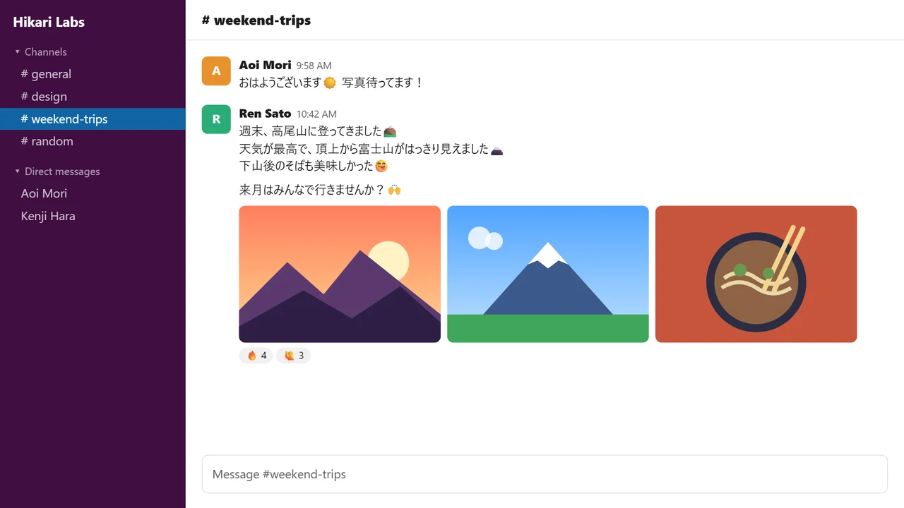

# Translate Popup

Chrome extension: select text, click the bubble, read the translation in a small glass card next to it.

- No length limit (long text is split and translated in chunks)
- Keeps line breaks, paragraphs and emoji (incl. image emoji on Slack, X, Discord)
- Auto-detects source; if already in target language, translates to EN/JA instead
- `Alt+T` or right-click → *Translate selection*
- Light/dark theme follows the system, or force it
- Glass effect on/off
- Settings: right-click the toolbar icon

## Install

1. Download the zip from the [latest release](https://github.com/azekyoo/translate-popup/releases/latest) and unzip it somewhere permanent
   (or `git clone` this repo)
2. `chrome://extensions` → enable **Developer mode**
3. **Load unpacked** → select the `translate-popup` folder

## Update

- **Zip:** unzip the new release into the *same* folder (replace the files). A new folder installs it as a separate extension and resets settings.
- **Git:** `git pull`

Then click **Reload** on the extension card. Open tabs pick up the new version without a refresh.

To get notified of new versions: **Watch → Custom → Releases** on this repo.

## Notes

Uses Google Translate's free public endpoint (unofficial, no API key). Google sometimes blocks it for a whole network
for a few minutes (HTTP 429); translation then switches automatically to Google's `translate-pa` API (the one
Simple Translate uses), which isn't affected. Line breaks may be slightly less exact during that time. If both fail,
the popup shows **Verify with Google**.

## Why?

I wasn't happy with the official Google Translate extension
