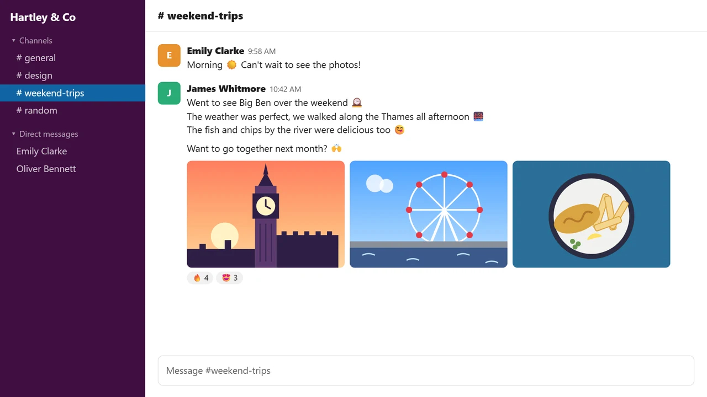

# Translate Popup

Chrome extension: select text, click the bubble, read the translation in a small glass card next to it.

- No length limit (long text is split and translated in chunks)
- Keeps line breaks, paragraphs and emoji (incl. image emoji on Slack, X, Discord)
- Auto-detects source; if already in target language, translates to EN/JA instead
- `Alt+T` or right-click → *Translate selection*
- Light/dark theme follows the system, or force it
- Glass effect on/off
- Pin the card so it stays open while you click around the page
- Settings: buttons on the card, or right-click the toolbar icon

## Install

**[Get it on the Chrome Web Store](https://chromewebstore.google.com/detail/translate-popup/kbmaganhckffnmjjhhpbggmeahfdldmd)**: updates install automatically.

Manual install (unpacked)

1. Download the zip from the [latest release](https://github.com/azekyoo/translate-popup/releases/latest) and unzip it somewhere permanent
   (or `git clone` this repo)
2. `chrome://extensions` → enable **Developer mode**
3. **Load unpacked** → select the `translate-popup` folder

To update: unzip the new release into the *same* folder (a new folder installs it as a separate extension and resets
settings), or `git pull`, then click **Reload** on the extension card. Watch → Custom → Releases on this repo to get
notified. If you switch to the store version, remove the unpacked one first so both don't run at once.

## Notes

Uses Google Translate's free public endpoint (unofficial, no API key). Google sometimes blocks it for a whole network
for a few minutes (HTTP 429); translation then switches automatically to Google's `translate-pa` API (the one
Simple Translate uses), which isn't affected. Line breaks may be slightly less exact during that time. If both fail,
the popup shows **Verify with Google**.

## Why?

I wasn't happy with the official Google Translate extension

---

# Translate Popup（日本語）

Chrome 拡張機能：テキストを選択してバブルをクリックすると、すぐ横の小さなガラス風カードに翻訳が表示されます。

- 文字数制限なし（長文は分割して翻訳）
- 改行・段落・絵文字を保持（Slack、X、Discord の画像絵文字にも対応）
- 翻訳元の言語を自動判定。すでに翻訳先の言語なら英語／日本語に翻訳
- `Alt+T` または右クリック →「*Translate selection*」
- ライト／ダークテーマはシステム設定に連動（固定も可能）
- ガラス効果のオン／オフ
- カードをピン留めすると、ページをクリックしても閉じません
- 設定：カードのボタン、またはツールバーのアイコンを右クリック

## インストール

**[Chrome ウェブストアから入手](https://chromewebstore.google.com/detail/translate-popup/kbmaganhckffnmjjhhpbggmeahfdldmd)**：アップデートは自動でインストールされます。

手動インストール（パッケージ化されていない拡張機能）

1. [最新リリース](https://github.com/azekyoo/translate-popup/releases/latest)から zip をダウンロードし、削除しない場所に解凍
   （またはこのリポジトリを `git clone`）
2. `chrome://extensions` →「**デベロッパー モード**」をオン
3. 「**パッケージ化されていない拡張機能を読み込む**」→ `translate-popup` フォルダを選択

アップデート方法：新しいリリースを*同じ*フォルダに解凍する（別のフォルダだと別の拡張機能としてインストールされ、設定がリセットされます）か、
`git pull` してから拡張機能カードの「**再読み込み**」をクリック。このリポジトリの Watch → Custom → Releases で新しいリリースの通知を
受け取れます。ストア版に切り替える場合は、両方が同時に動かないよう、先にパッケージ化されていない版を削除してください。

## 注意事項

Google 翻訳の無料公開エンドポイント（非公式、API キー不要）を使用しています。Google がネットワーク全体を数分間ブロックすることがあり
（HTTP 429）、その間は Google の `translate-pa` API（Simple Translate が使用しているもの）に自動で切り替わります。こちらはブロックの影響を
受けません。その間、改行の再現がやや不正確になる場合があります。両方とも失敗した場合は、ポップアップに「**Verify with Google**」が表示されます。

## なぜ作ったか

公式の Google 翻訳拡張機能に満足できなかったからです。
