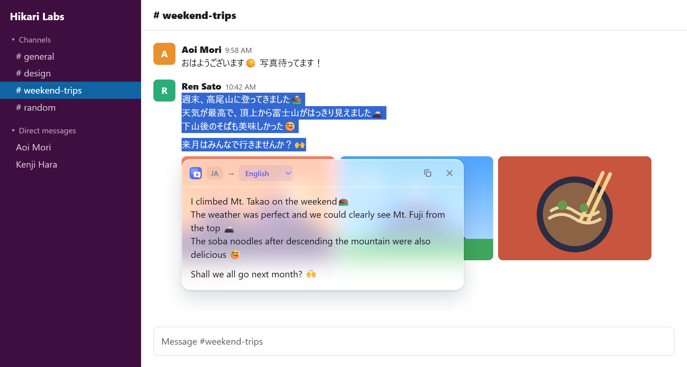
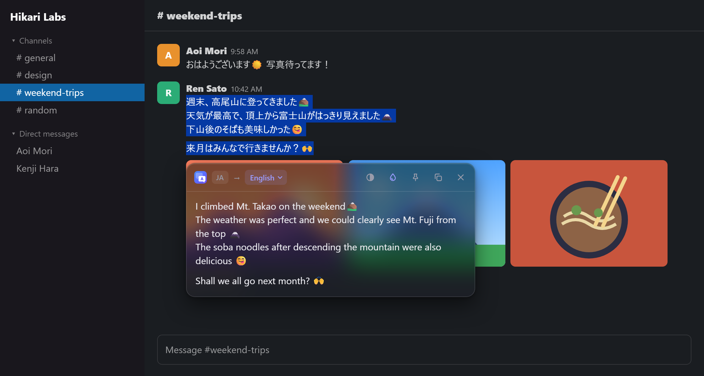

# Translate Popup

Chrome extension: select text, click the bubble, read the translation in a small glass card next to it.

- No length limit (long text is split and translated in chunks)
- Keeps line breaks, paragraphs and emoji (incl. image emoji on Slack, X, Discord)
- Auto-detects source; if already in target language, translates to EN/JA instead
- `Alt+T` or right-click → *Translate selection*
- Toolbar icon toggles glass effect on/off
- Light/dark theme follows the system

## Install

1. `chrome://extensions` → enable **Developer mode**
2. **Load unpacked** → select this folder

Uses Google Translate's free public endpoint (unofficial, no API key).

## Why?

I wasn't happy with the official Google Translate extension
